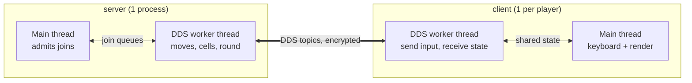
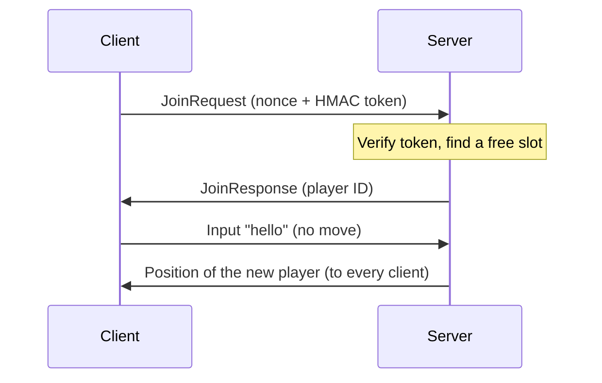
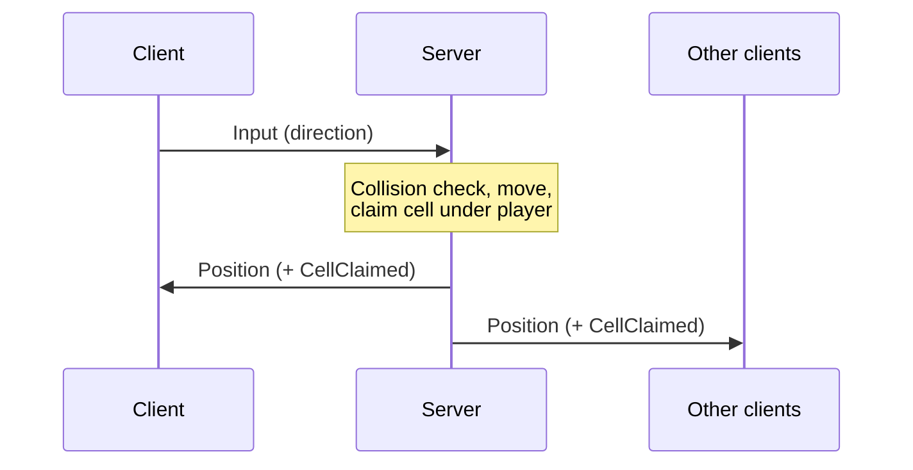
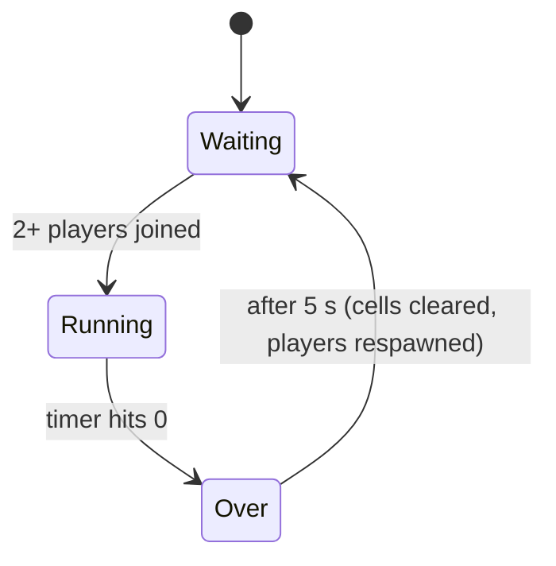

# Color the Floor

A real-time, distributed and secure multiplayer game for **CSD3116** (Week 1
Team Lab). Players move squares around a grid and claim every floor cell they
walk over. Built in C on Cyclone DDS, OpenGL/GLFW and OpenSSL.

- A **60 s round** starts once **2 players** have joined (up to 5).
- Walk over a cell to paint it your colour, even if someone else painted it first.
- When time runs out, **most cells wins**. A new round starts 5 s later.
- A 6th player **spectates** and joins automatically when a slot frees up.

## Quick start

Tested on WSL (Ubuntu 24.04).

```bash
sudo apt install build-essential libgl1-mesa-dev libglfw3-dev cyclonedds-dev cyclonedds-tools libssl-dev pkg-config
make            # builds server + client (runs idlc for you)
./server        # terminal 1
./client        # terminal 2, 3, ... one per player
```

Click inside a client window, then use the **arrow keys**. Close the window
(or press Ctrl+C) to leave.

```bash
make test       # unit tests
make clean      # remove binaries and generated files
```

---

## Project structure

| Layer | Files | Role |
|---|---|---|
| **Programs** | `server.c` | Authoritative game server |
| | `client.c` | One per player: networking, input, main loop |
| | `render.c` / `.h` | Client drawing (OpenGL) from a state snapshot |
| **Shared logic** | `game_logic.c` / `.h` | Players: collision, spawning, movement |
| | `grid_logic.c` / `.h` | Floor: cell claiming, scores, winner, timer |
| **Security** | `security.c` / `.h` | Authentication and encryption (OpenSSL) |
| **Messages** | `messages.idl` | DDS message definitions (`idlc` generates `messages.c/.h`) |
| **Tests** | `test_*.c` | Unit tests for the shared logic and security |
| **Build** | `Makefile` | `make`, `make test`, `make clean` |
| **Vendored** | `stb_easy_font.h` | Text rendering |

The shared logic and security modules have **no DDS or GLFW dependency**, so
they are unit-tested on their own and used unchanged by both programs.

---

## Architecture



**The server is the single source of truth.** Clients only send key presses
and draw what the server tells them.

### Threads

Each program has two threads, sharing state under one mutex. Neither thread
polls: they sleep until there is work.

| Thread | Does | Wakes up when |
|---|---|---|
| Server main | Allocates player slots for join requests | A join is queued (condition variable) |
| Server DDS worker | Applies moves, claims cells, runs the round, publishes updates | DDS data arrives, or every 100 ms (waitset) |
| Client main | Reads arrow keys, renders at 60 FPS | Every frame |
| Client DDS worker | Sends joins/input, receives game state | DDS data arrives or a key changes (waitset) |

### DDS topics

| Topic | Direction | Keyed by | Purpose |
|---|---|---|---|
| `JoinRequest` | client → server | - | Join, with a credential (HMAC) |
| `JoinResponse` | server → clients | - | Player ID, or 0 = game full |
| `Input` | client → server | player ID | Arrow-key direction |
| `Position` | server → clients | player ID | A player's square, sent when it moves |
| `CellClaimed` | server → clients | cell (x, y) | A cell's new owner |
| `GameState` | server → clients | - | Timer, round started/over, winner (every 1 s) |

`Position` and `CellClaimed` are **transient-local**: a client that joins late
is handed every current position and cell owner straight away.

---

## Program flow

### 1. Joining



- Claimed cells and other players' positions reach a new client as soon as it
  connects, because those topics are transient-local.
- The client resends `JoinRequest` every second until answered. A repeated
  request gets the **same** slot, never a second one.
- If the game is full the answer is player ID 0: the client **spectates** and
  keeps retrying.
- A slot that sends no `Input` within 10 s is freed again.

### 2. Moving



Holding a key sends one move every 150 ms, so the square steps one cell at a
time.

### 3. A round



While **Running**, the server claims the cell under each player. In **Over**,
moves are frozen and every client shows the winner.

### 4. Leaving

1. Closing the client shuts down its DDS participant.
2. The server sees the player's `Input` instance lose its writer.
3. The server frees the slot, unclaims their cells and unregisters their `Position`.
4. Other clients remove the square and show *"Player N left the game"*.

If the **server** stops (Ctrl+C) or restarts, clients see it immediately,
clear the old floor and rejoin by themselves once a server is back. If it
crashes instead, they notice within about 10 s (DDS's liveliness timeout).

---

## Unit tests

```bash
make test
```

Plain C with a small `TEST_ASSERT` macro, no test framework. No DDS, GLFW or
`idlc` needed; `test_security` links OpenSSL.

| Suite | Tests | Covers |
|---|---|---|
| `test_game_logic` | 18 (30 checks) | Collision edges and overlaps, free-slot search, spawning in bounds without overlap, moves in every direction, window and HUD borders, grid alignment |
| `test_grid_logic` | 15 (42 checks) | Cell under a square (centre, corners, clamping), claiming and stealing cells, running score counts, winner and draws, round timer |
| `test_security` | 21 (42 checks) | Join token accepted/rejected/bound to nonce, encrypt/decrypt round trip, tampered, truncated, oversized and forged ciphertexts, message-type and key binding, replays, key override from environment |

Each suite prints how many checks passed and exits non-zero on any failure.

### Integration checks and benchmarks (`tools/`)

Headless DDS clients that run against the real server, no windows needed:

| Command | What it does |
|---|---|
| `make integration` | ~1 min of PASS/FAIL checks: repeated joins get the same slot, silent slots are freed, replayed input is ignored, late joiners see the right players, Ctrl+C shuts the server down cleanly |
| `make bench` | Builds the pre-optimization commit and the current code side by side in `build/`, then measures both (latency, CPU per thread) |
| `bash tools/load.sh build/new 20` | Puts a running server under a fixed load (4 idle players + 1 moving) for 20 s, eg while `perf record` or `strace -c` runs |

To profile, build both versions with symbols (`bash tools/build_versions.sh`
does this by default), start `build/old/server` or `build/new/server` under
the profiler, and drive it with `tools/load.sh` using the same build folder.

---

## Security

| Feature | How |
|---|---|
| **Client authentication** | `JoinRequest` carries an HMAC-SHA256 of a random nonce under a pre-shared key. The key itself is never sent. |
| **Encryption** | Every server and input message is AES-256-GCM encrypted; plaintext fields are blanked. |
| **Tamper-proofing** | Each ciphertext is bound to its message type and DDS key, so it can't be moved to another player or cell. |
| **Replay protection** | Each ciphertext carries a sequence number; receivers drop anything not newer. |

To use your own keys, export the same values on the server and every client:

```bash
export CSD3116_AUTH_PSK=$(openssl rand -hex 32)
export CSD3116_AES_KEY=$(openssl rand -hex 32)
```

Known limitations (details in `security.c`):

- All clients share one key, so this protects against **outsiders**, not a
  malicious player.
- The built-in default keys are in the source, kept so the game runs out of
  the box for grading.

---

## Optimizations

Measured on WSL2, both builds at `-O2`, against the code before this pass
(commit `5c982eb`).

| Metric | Before | After |
|---|---|---|
| Key press → new position, 2 players | 51.2 ms | **1.6 ms** |
| Key press → new position, 5 players | 156.4 ms | **1.5 ms** |
| Server CPU, 5 idle players | 3.3% | **0.3%** |
| Client network thread CPU | 2.1% | **0.2%** |
| Client frame rate | ~53 FPS | **~59.5 FPS** |

- **No sleeping while holding the lock**: the server slept 20 ms per player with the mutex held.
- **Event-driven threads**: DDS waitsets and a condition variable replace 1 ms polling loops.
- **Publish on change**: positions are sent when they change, not for every player every 100 ms.
- **Non-blocking move throttle**: the client no longer sleeps 150 ms after each move.
- **No rescans per frame**: per-player cell counts are kept as running totals.
- **Frame pacing**: the client sleeps only for the rest of each 1/60 s frame.

ThreadSanitizer found no data races in the game code. The client's total CPU
rises slightly because it now draws about 12% more frames.
